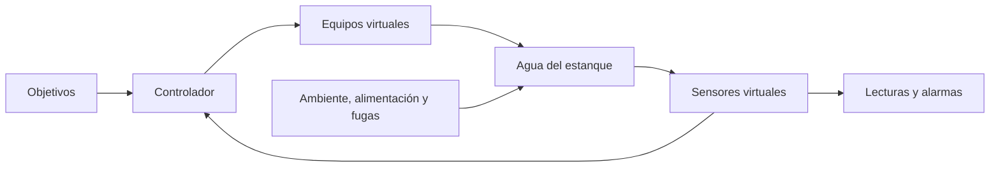

# Cómo funciona AquaControl y cómo presentarlo

Revisión del 19 de octubre de 2026. Basada en `PROJECT_SPEC.md`, `MATHEMATICAL_MODEL.md`, `MODEL_DEFAULTS.json`, `ACCEPTANCE_PLAN.md` y el código ejecutable de esta carpeta.

## Qué controla

AquaControl simula el control de la calidad y del nivel del agua de un estanque de piscicultura. Mantiene cinco variables cerca de objetivos definidos para el experimento. No controla el crecimiento ni el peso de los peces: la biomasa es un parámetro fijo. No está conectado a equipos físicos.

| Variable controlada | Sensor virtual | Equipo que permite corregirla |
|---|---|---|
| Temperatura, °C | Termómetro | Calefacción o enfriamiento |
| Oxígeno disuelto, mg/L | Sensor de oxígeno | Aireador |
| pH | Sensor de pH | Acción virtual para subir o bajar el pH |
| Turbidez, NTU | Sensor de turbidez | Filtro |
| Nivel, m | Sensor de nivel | Entrada o salida de agua |

Son cinco variables controladas y ocho acciones de equipos. El cálculo también incorpora cinco estados internos que representan la respuesta gradual de los equipos; no son nuevas variables de calidad del agua.

## Dónde están las entradas, parámetros y salidas

El significado de «entrada» depende de qué parte se observa: el controlador recibe mediciones y objetivos; el estanque recibe las acciones de los equipos y las perturbaciones.

| Elemento | Qué significa | Dónde se configura o se observa |
|---|---|---|
| Referencias u objetivos | Valores que se quiere mantener | Configuración → Referencias, bandas y alarmas; también en las tarjetas y líneas de las gráficas |
| Condiciones iniciales | Estado del agua al comenzar | Configuración → Condiciones iniciales del agua |
| Parámetros del proceso | Área, altura, biomasa, presión, salinidad y coeficientes de respuesta | Campos del estanque y Configuración → Sensores y parámetros del modelo |
| Parámetros de medición | Ruido y sesgo de cada sensor | Configuración → Sensores y parámetros del modelo |
| Parámetros de control | Umbrales de histéresis y memoria del modo anterior | `MODEL_DEFAULTS.json`, sección `controller`; guardados en cada configuración histórica |
| Entradas al controlador | Lecturas de los sensores, su calidad y referencias | Se producen en cada muestreo; se registran con las decisiones |
| Entradas manipuladas al estanque | Calor/frío, aireación, corrección virtual de pH, filtración y caudales | Las calcula el controlador; se observan en el panel y la gráfica de equipos |
| Perturbaciones externas | Temperatura ambiental, alimentación, fugas, lluvia y aportes externos | Escenario y calendario de perturbaciones |
| Fallos | Sensor ausente, congelado o sesgado, o capacidad reducida de un equipo | Calendario del escenario |
| Salidas del proceso | Temperatura, oxígeno, pH, turbidez y nivel que resultan del cálculo | Estanque y gráficas de evolución |

Las bandas expresan el rango de operación deseado. Los límites de alarma generan avisos. Estos límites no sustituyen los umbrales de encendido y apagado del controlador.

## El ciclo real del programa

1. La aplicación valida y guarda una configuración fija para la corrida. Prepararla no avanza el tiempo.
2. En el primer paso obtiene la primera muestra del agua. Las lecturas incorporan el ruido, sesgo y fallos configurados.
3. El controlador recibe la muestra más reciente, las referencias y su memoria. No recibe el estado exacto del agua ni el calendario oculto de fallos.
4. En lazo cerrado decide qué equipos activar usando histéresis. En lazo abierto mantiene las órdenes constantes calculadas para el equilibrio nominal.
5. Los equipos responden gradualmente. Su capacidad disponible puede reducirse por una avería.
6. Se calcula la evolución del agua durante un intervalo mediante las ecuaciones y el integrador RK45. Los resultados no se fuerzan al objetivo.
7. Al final del intervalo se obtiene otra muestra, se evalúan alarmas y se guarda el paso de forma atómica en SQLite. El ciclo se repite.

El intervalo predeterminado es de 60 segundos simulados. La demostración solicita un paso cada tres segundos de pantalla; no es tiempo real del estanque. La vista utiliza los registros guardados del simulador. Las burbujas y los peces son recursos de representación; no calculan el proceso físico.

## Cómo decide el control cerrado

- Temperatura: comienza a calentar por debajo del objetivo menos 0,3 °C; comienza a enfriar por encima del objetivo más 0,3 °C. Desactiva al volver al objetivo.
- Oxígeno: activa el aireador cuando la lectura es menor o igual al objetivo menos 0,2 mg/L. Desactiva al llegar al objetivo más 0,2 mg/L.
- pH: inicia la corrección al separarse más de 0,15 del objetivo y desactiva al volver a él.
- Turbidez: enciende el filtro al alcanzar 15 NTU y lo apaga al bajar a 10 NTU. Estos umbrales son fijos en esta versión; no se recalculan al editar la referencia de turbidez.
- Nivel: inicia el llenado o vaciado al separarse más de 0,03 m del objetivo y desactiva al volver a él.

La histéresis conserva el modo entre umbrales para evitar conmutaciones continuas. Las acciones opuestas de cada pareja no se aplican simultáneamente. Las alarmas solo avisan: reconocer una alarma no corrige el agua.

Una medición requerida ausente o inválida detiene el control cerrado según la política documentada. Un sesgo plausible o una lectura congelada que parece válida pueden pasar inadvertidos. Una fuga mayor que la capacidad de reposición puede hacer fallar la corrida: eso es un límite del control, no una razón para forzar el nivel al objetivo.

## Cómo mostrarlo en una presentación

1. Seleccione una especie, S2 · Recuperación y Lazo cerrado · histéresis. S2 comienza con agua apartada de los objetivos para hacer visible la corrección.
2. Pulse Validar y preparar corrida.
3. En Ejecución y evolución pulse Iniciar demostración. Observe las lecturas, el nivel, los equipos activos y las alarmas en el estanque.
4. Explique: «El sistema mide el agua, compara con los objetivos y activa los equipos para corregir la diferencia». Señale un caso: con oxígeno bajo se activa la aireación; con turbidez alta se activa la filtración.
5. Las gráficas muestran el agua simulada y la lectura del sensor. La línea punteada es el objetivo; la franja verde es el rango deseado. La gráfica de equipos muestra cuánto actuó cada equipo en cada intervalo.
6. Use Pausar para explicar un instante. Iniciar demostración reanuda el avance automático; Continuar habilita nuevamente el avance manual. Avanzar un intervalo calcula un solo paso.
7. Ejecutar hasta terminar calcula el resto sin esperar la demostración. Los resultados detallados, eventos y descargas están en Historial y exportación. Comparación ejecuta ambas estrategias con las mismas condiciones para evaluar sus diferencias.

Para demostrar limitaciones, S5 muestra la respuesta a una lectura ausente y S9 una fuga que supera la reposición. «Fallida» en estos ensayos puede ser el resultado previsto por el plan: no significa necesariamente un defecto del programa.

## Alcance de la comprobación

El plan AC01–AC20 comprueba configuración, balances, respuesta de equipos, histéresis, equilibrio, reproducción, recuperación, perturbaciones, fallos, pausa, almacenamiento, refinamiento numérico, indicadores y ejecución sin red. La evidencia de esta revisión se guarda en `evidence/revision_control_2026-10-19/` y su resumen en `REVISION_CONTROL_2026-10-19.md`.

Que las pruebas de software pasen no acredita funcionamiento en una instalación real. El modelo no incluye estratificación, crecimiento, reproducción, enfermedades, amoníaco ni química completa. El pH y la turbidez son aproximaciones empíricas; la acción de pH no equivale a una dosis química. La validación de campo y la aceptación de rendimiento sobre el equipo de referencia requieren comprobaciones adicionales.
